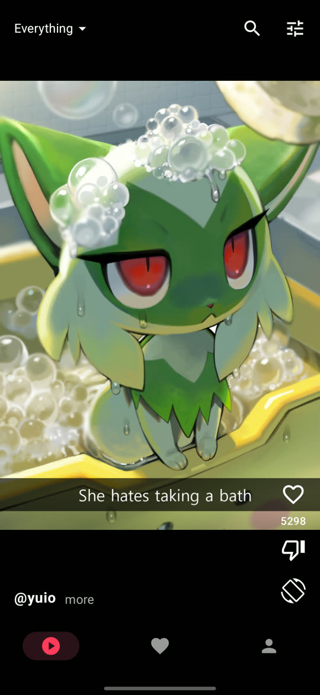
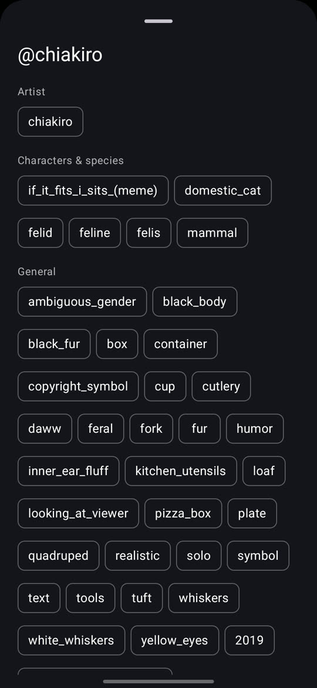
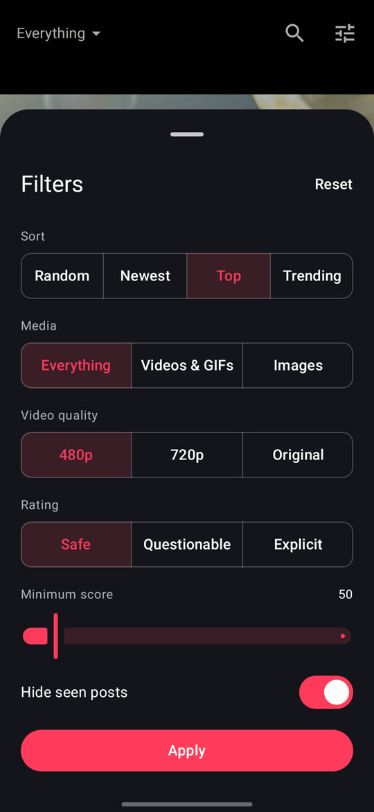
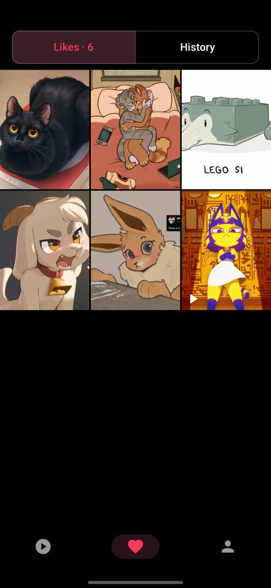
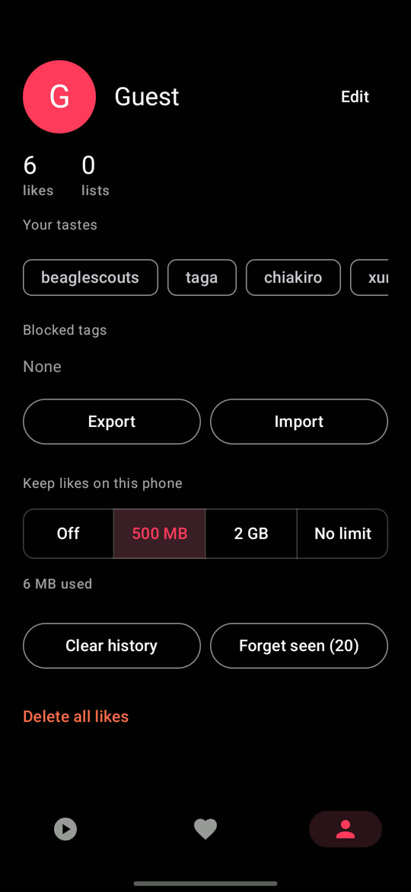

<p align="center">
  
</p>

<h1 align="center">Penumbra</h1>

<p align="center">
  An unofficial <b>e621 client for Android</b>: a vertical, full-screen feed of images, GIFs and videos,
  steered by tag lists and a "For you" list that learns from what you like.
</p>

<p align="center">
  <a href="../../releases/latest">Download the APK</a>
</p>

> **Adult content.** e621 hosts explicit material. Penumbra asks for 18+ confirmation on first launch,
> hosts nothing and moderates nothing: it only fetches from e621's public API.
> Penumbra is not affiliated with or endorsed by e621.

## Screenshots

<p align="center">
  
  
  
  
  
</p>

<sub>Taken with the rating filter set to Safe. Artwork belongs to its artists.</sub>

## What it does

- **Reels-style feed** for e621: swipe through posts one at a time, edge to edge. The next videos are
  preloaded, so swiping to them is instant.
- **Tag lists**: any of the tags or all of them, plus blocked tags. Autocomplete uses e621's own tag index.
- **For you**: a list built from your likes (rarer tags weigh more, broad ones like `mammal` never do). Tap
  "less like this" on a post and it counts against that post's tags.
- **Quick search**: type tags (`-tag` to exclude) and the feed shows them right away.
- **No account, no cloud**: likes, lists, history and the "already seen" memory live on the phone. Likes can
  also be kept as local copies, so they still open if a post is deleted from e621.
- **Video controls**: seek bar, speed, mute, rotate to landscape (swipes locked while rotated).
- **Filters**: sort order, images / videos, rating, minimum score, and video quality (480p, 720p, original).
- **Save to phone**: send the original file to the gallery.
- **Backup**: export and import likes, lists and "For you" tweaks as JSON.

## Install

1. Download `Penumbra-*.apk` from the [latest release](../../releases/latest).
2. Open it on your phone and allow installing from this source when asked.

Requires Android 8.0 (API 26) or newer.

## Build

Needs JDK 17 and the Android SDK (platform 35).

```bash
./gradlew :app:assembleDebug      # debug APK
./gradlew :app:assembleRelease    # release APK (set up your own signing key first)
./gradlew :app:testDebugUnitTest  # unit tests
```

The release build signs with `keystore/penumbra.keystore` when it exists. That file is intentionally not in
the repository; without it the build falls back to the debug key. To publish your own builds, create a key
(`keytool -genkeypair ...`) and keep it safe: Android only updates an app in place when the signature matches.

## Built with

Kotlin, Jetpack Compose, Media3 (ExoPlayer), Coil, Room, DataStore, OkHttp, kotlinx.serialization.

## e621 etiquette

Penumbra sends a descriptive `User-Agent` and stays under about 1.4 requests per second (e621 allows 2).
If you fork it, please keep that, and put your own contact in the `User-Agent`.

## Privacy

No analytics, no ads, no sign-in. The only network traffic is to e621 (its API and image/video servers).
